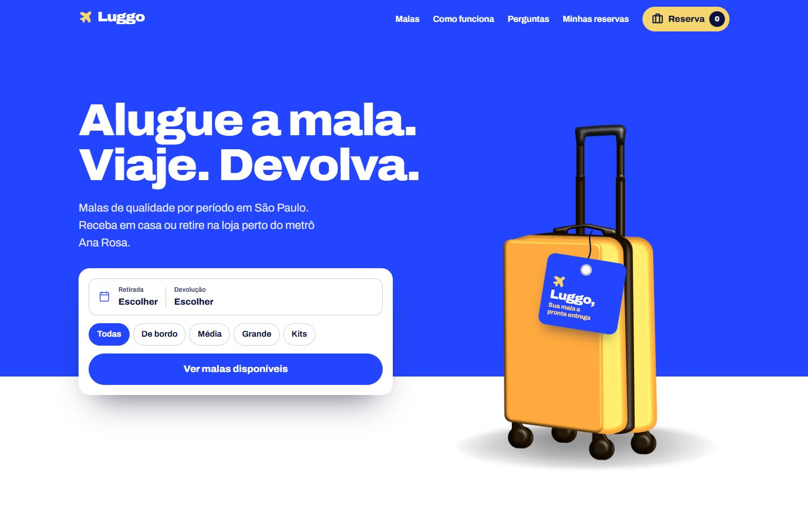
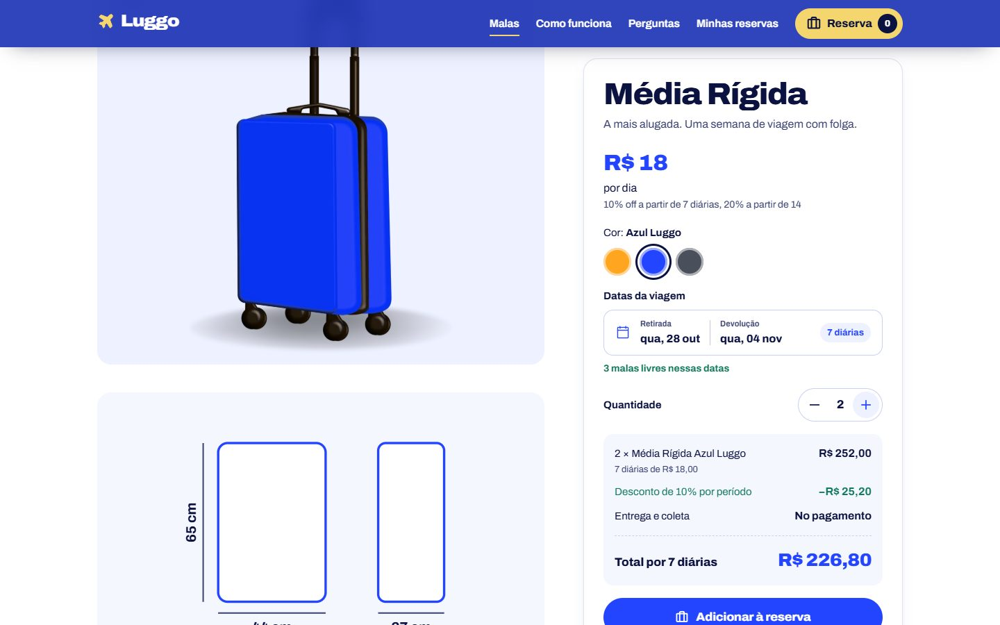
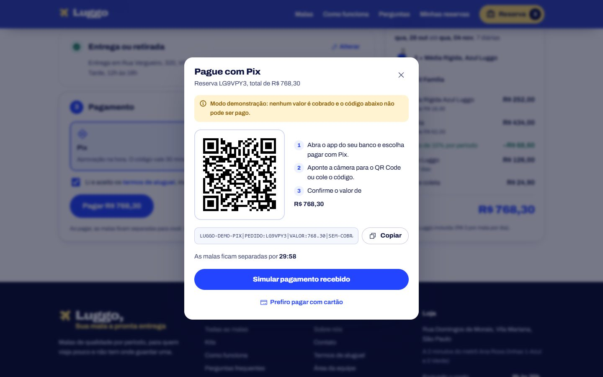
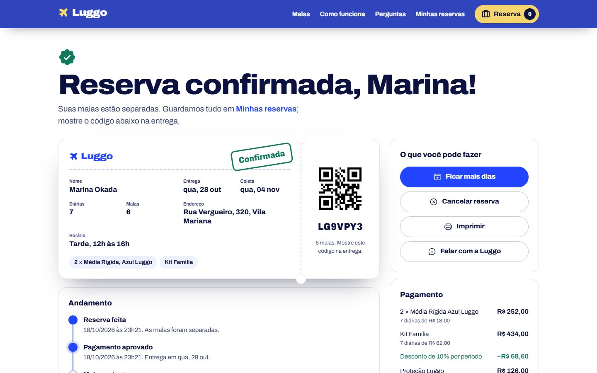
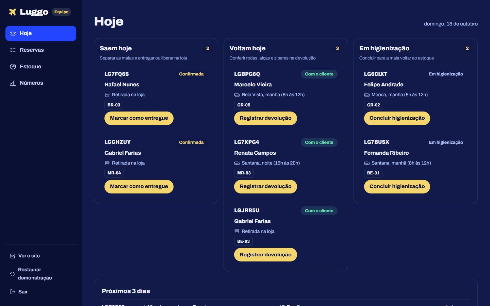
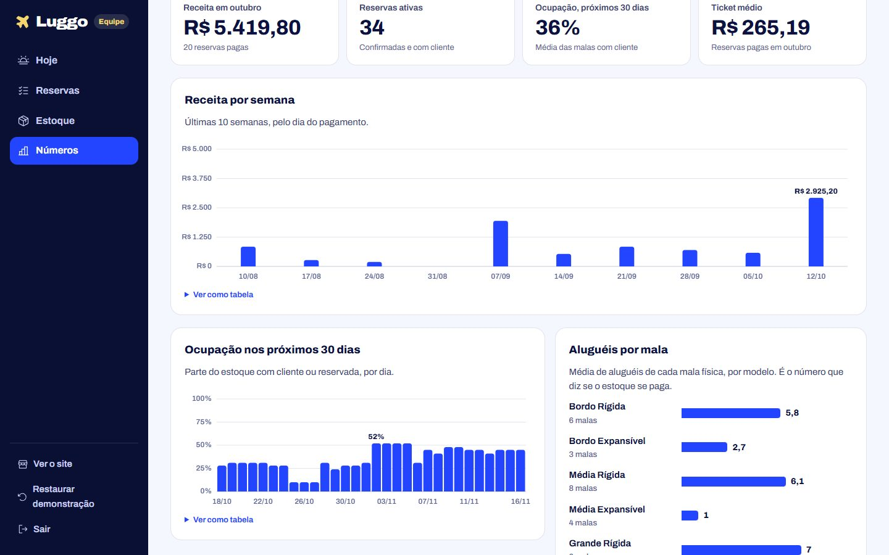

# Luggo

Site de aluguel de malas da Luggo, startup de São Paulo: o cliente escolhe a mala, vê na hora o que está livre nas datas da viagem, paga com Pix ou cartão e recebe em casa ou retira na loja. A equipe acompanha tudo num painel próprio.

> Projeto demonstrativo. A Luggo é uma startup fictícia criada como projeto de empreendedorismo; os dados são de exemplo e nenhum pagamento é cobrado.



## O que dá para fazer

**Cliente**

- Buscar por datas e tamanho, com calendário que mostra os dias esgotados e respeita o mínimo de diárias e o dia de higienização entre aluguéis.
- Ver cada mala com medidas desenhadas em escala, ficha técnica e preço do período já com desconto.
- Montar a reserva com várias malas e kits, ligar a Proteção Luggo e ver o total na hora.
- Pagar em três etapas: dados, entrega ou retirada (com CEP consultado no ViaCEP e área de entrega da capital) e pagamento.
- Pix com QR Code, copia e cola e contagem de 30 minutos; cartão pelo Mercado Pago, inclusive o caso de cartão recusado.
- Acompanhar a reserva num cartão de embarque com QR de retirada e linha do tempo, ficar mais dias (só se as mesmas malas estiverem livres) e cancelar dentro do prazo.

**Equipe** (`/equipe`, PIN de demonstração `2026`)

- Hoje: o que sai, o que volta, o que está atrasado e o que está em higienização, com o código de cada mala física.
- Reservas: busca, filtros por situação e avanço de status.
- Estoque: as 30 malas uma a uma, com situação, próxima saída e manutenção.
- Números: receita por semana, ocupação dos próximos 30 dias e aluguéis por mala.

| | |
|---|---|
|  |  |
|  |  |
|  |  |

## Como rodar

Precisa do Node.js 20 ou mais novo.

```bash
npm install
npm run dev
```

O site abre em `http://localhost:5173`. Outros comandos:

| Comando | O que faz |
|---|---|
| `npm test` | Testes das regras de negócio (preço, disponibilidade, pedidos, CEP, painel) |
| `npm run build` | Gera o site em `dist/` |
| `npm run preview` | Abre o site gerado |
| `npm run icons` | Regenera os ícones a partir de `scripts/icons.json` |

## Publicar

O workflow `.github/workflows/deploy.yml` roda os testes, gera o site e publica no GitHub Pages a cada push na `main`. No repositório, vá em **Settings > Pages** e escolha **GitHub Actions** como fonte. Na conta gratuita, o repositório precisa ser público.

## Como é feito

- **React 19, TypeScript e Vite**, com rotas do React Router e animações com Motion (carregado de forma enxuta com `LazyMotion`).
- **CSS Modules** com a identidade da Luggo: azul `#2445FF`, amarelo `#F5D66E`, a fonte Archivo e a mala 3D em camadas, que chega rolando na página inicial.
- **Ícones Phosphor** gerados só com os pesos usados, para o site carregar mais rápido.
- **Camada de serviços** (`src/services`) isolada das telas: hoje os dados ficam no navegador (`localStorage`), com uma latência simulada para as telas terem estados de carregamento de verdade. Para ligar um backend, só essa camada muda.
- **Acessível**: navegação por teclado (inclusive no calendário), foco visível, textos alternativos, contraste AA, modo escuro e respeito a quem prefere menos movimento.

```
src/
  config/business.ts   preços, prazos, loja e área de entrega (tudo o que a equipe ajusta)
  data/                catálogo, perguntas frequentes e dados de demonstração
  services/            disponibilidade, preço, pedidos, pagamentos, CEP e números do painel
  state/               reserva em montagem e hooks
  components/          calendário, cartão de embarque, gráficos, modal...
  pages/               telas do cliente e, em admin/, as da equipe
```

## Pagamento de verdade

Nesta versão o Mercado Pago é simulado: o código Pix gerado não pode ser pago e o site nunca pede o número do cartão. Para cobrar de verdade, uma função serverless guarda o Access Token, cria o pagamento Pix ou a preferência do Checkout Pro e recebe o webhook de aprovação. O passo a passo está em `src/services/payments.ts`.

## Créditos

Mala 3D e ilustração: apresentação da equipe Luggo (Enzo, Bianca e Rikelmy). Fonte Archivo (SIL Open Font License). Ícones Phosphor (MIT). CEP pelo [ViaCEP](https://viacep.com.br).
